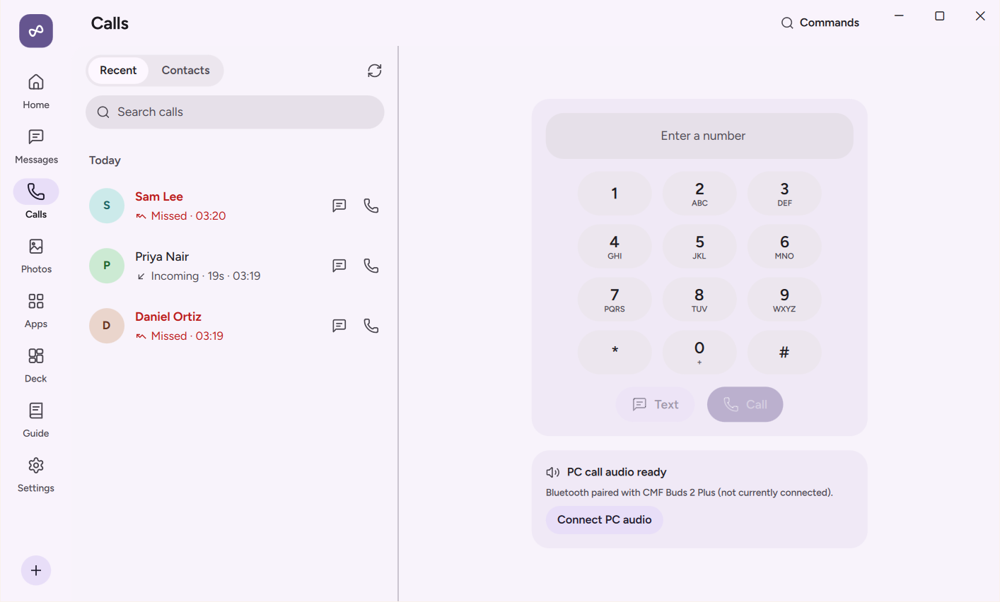

# Calls

The **Calls** page on your PC lets you see incoming phone calls with caller ID, answer or decline them from your desk, reject a call with a quick SMS reply, dial numbers from a keypad, browse your recent call history and contacts, and control active calls.

  

## What You Need

| Requirement | Details |
| :--- | :--- |
| **Android Permissions** | **Calls on your PC** (`READ_PHONE_STATE`, `READ_CALL_LOG`, `ANSWER_PHONE_CALLS`, `CALL_PHONE`) and **Contacts on your PC** (`READ_CONTACTS`) in **Settings › Permissions › Calls, contacts and messages**. |
| **Android Power Level** | `Standard` for incoming call alerts, caller ID, answer, decline, hang up, call log, dialer, and volume control. `Elevated` (on Android 12+) enables in-call **Mute**, **Speakerphone**, **Hold**, and **Keypad (DTMF)** controls from the PC. |
| **Per-Device Toggles** | **Calls** and **Contacts** (both enabled by default in **Settings › Devices** on the PC). |
| **Network** | Local network, USB cable, or **Connect over mobile data**. |

## Step-by-Step Use

### Handling Incoming Calls on Your PC

1. When your phone rings, NectarLink displays an incoming call banner on your PC (and expands `Nectar Island` if enabled) showing the caller's name, phone number, and contact photo.
2. If **Pause media during calls** is enabled in **Settings › Camera & Audio**, any music or video playing on your PC pauses automatically while the phone is ringing or in a call, and resumes when the call ends.
3. From the incoming call banner on your PC, you can:
   - Click **Answer** to pick up the call on your phone.
   - Click **Decline** to send the caller to voicemail.
   - Click **Silence** to mute the ringer without declining the call.
   - Click **Reply with text** (when SMS access is enabled) to decline the call and immediately send a preset or custom SMS reply to the caller.

### Controlling an Active Call

While a call is active on your phone, the call bar on your PC shows the live call timer and provides controls based on your phone's power level:

- **At `Standard` or `Assist`**: You can see the active call duration, adjust the call volume, and click **Hang up** to end the call.
- **At `Elevated` (Android 12 and newer)**: Additional in-call controls appear on the PC card, allowing you to toggle **Mute**, switch the phone to **Speaker** (speakerphone), place the call on **Hold**, or open the in-call **Keypad** to send DTMF tones for automated phone menus.

### Placing a Call from Your PC

1. Open **Calls** in the left navigation bar on your PC.
2. You can start a call in three ways:
   - **From the Keypad**: Type or paste a phone number into the dialer keypad (or press number keys on your keyboard) and click **Call**.
   - **From Contacts**: Search your synced phone contacts (favorites appear at the top) and click the call button next to any number.
   - **From Recent Calls**: Click any entry in your recent call history to call back or open a text conversation with that person.
3. Your phone places the cellular call immediately.

### Browsing Call History

The **Calls** page groups your phone's recent incoming, outgoing, and missed calls by day. Missed calls are highlighted in red and summarized on your PC's Home screen until viewed. A voicemail notification from your phone appears in the notification feed like any other notification.

## Why Call Voice Audio Stays on Your Phone

When you answer or place a call from your PC, NectarLink controls the call on your phone while the voice audio itself remains on your phone's earpiece, speakerphone, or Bluetooth headset paired directly to your phone.

This is due to two operating system restrictions (documented in detail in [`docs/research/hfp.md`](../research/hfp.md)):

1. **Android hardware voice routing**: On non-rooted Android devices, cellular call audio (`VOICE_CALL`, `VOICE_DOWNLINK`, `VOICE_UPLINK`) is routed by the modem DSP and blocked from software capture (`AudioPlaybackCapture` explicitly excludes voice communication, even at the `Elevated` shell level).
2. **Windows 11 Bluetooth HFP restrictions**: Windows' `AudioPlaybackConnection` API only supports one-way A2DP media playback (not two-way Hands-Free Profile voice channels), and Microsoft's `PhoneLineTransportDevice` HFP broker on Windows 11 22H2 and newer rejects third-party applications with `E_ACCESSDENIED` unless they run with Microsoft's internal inbox system identity or a WHQL-signed kernel driver.

For hands-free calling at your desk, click **Speaker** in NectarLink's call bar (with `Elevated`) or keep your wireless headphones paired to your phone via multipoint Bluetooth.

## What the Options Do

- **Calls toggle** (`Settings › Devices` on PC, **On** by default): Enables caller ID, call log sync, incoming call alerts, and call control for that phone.
- **Contacts toggle** (`Settings › Devices` on PC, **On** by default): Syncs your phone's contacts so caller ID and the dialer show names and photos.
- **Pause media during calls** (`Settings › Camera & Audio` on PC, **On** by default): Automatically pauses active Windows media playback when a call rings or connects on your phone, and resumes playback when the call finishes unless you manually changed playback in the meantime.
- **Island triggers › Calls** (`Settings › General` on PC, **On** by default when `Nectar Island` is enabled): Shows incoming and active phone calls inside the top-of-screen `Nectar Island` pill.

## Data and Privacy

- **Where data travels**: Call state changes, caller ID metadata, recent call log entries, and contact records travel directly between your phone and PC over your end-to-end encrypted QUIC connection.
- **Where data stays**: Recent call logs and contacts are read live from your phone and held in memory on the PC during your session. NectarLink never records call audio.

## Limits

- **Two-Way Call Audio on PC**: As explained above, public Windows and Android APIs do not permit third-party apps to route cellular voice audio through PC speakers and microphones without a kernel driver or system-signed OEM firmware.
- **In-Call Mute, Hold, Speaker, and DTMF Keypad**: Standard Android permissions allow third-party apps to answer and end calls (`TelecomManager`), but muting the microphone, toggling speakerphone, holding a call, and sending DTMF tones during a cellular call require `Elevated` on Android 12 or newer unless the app replaces your default phone dialer.
- **Dual-SIM Selection**: When you place a call from the PC on a dual-SIM phone, Android uses the default calling SIM configured in your phone's SIM settings (or prompts on the phone if your SIM preference is set to "Ask every time").
