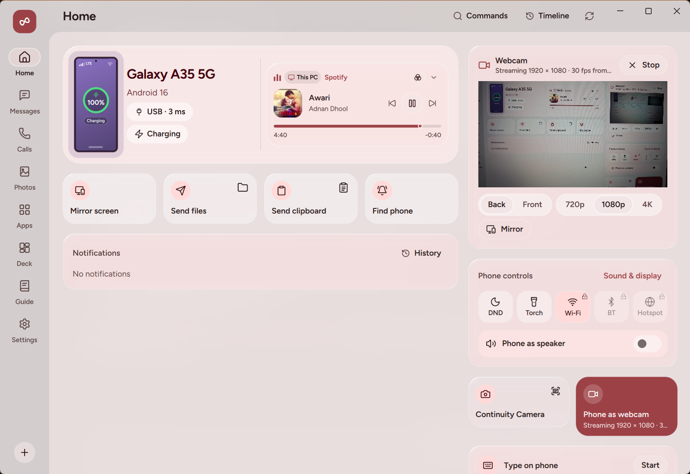
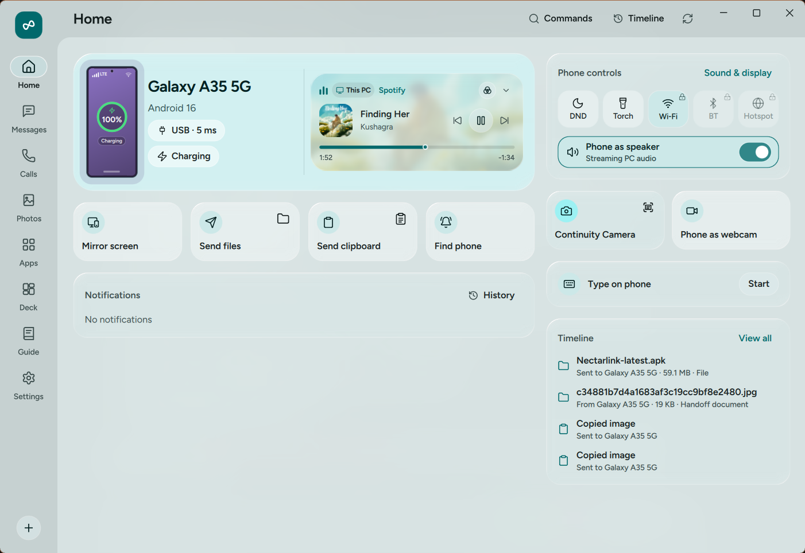

# Cameras and Audio

NectarLink lets your PC use your phone's cameras and audio hardware in four ways: streaming your phone's camera as a Windows webcam (`NectarLink Webcam`), snapping photos or scanning documents straight into your PC clipboard (**Continuity Camera**), playing your PC's system audio through your phone (**Phone as speaker**), and recording voice notes on your phone that land automatically on your PC (**Voice recorder**).

  

## What You Need

| Feature | Requirements |
| :--- | :--- |
| **Phone as webcam** | `Standard` power level. Android **Camera** permission (`CAMERA`, requested when you start the webcam). **Webcam** per-device toggle enabled in PC **Settings › Devices** (on by default). To use the camera inside third-party apps (Zoom, Teams, Meet, OBS, Windows Camera), click **Set up** next to **Virtual camera add-on** in PC **Settings › Camera & Audio** (one-time administrator prompt on Windows 11). |
| **Continuity Camera (Take photo / Scan document)** | `Standard` power level. Android **Camera** permission. **Webcam** toggle enabled. |
| **Phone as speaker (Stream PC audio to phone)** | `Standard` power level. **Media controls** per-device toggle enabled in PC **Settings › Devices** (on by default). |
| **Voice recorder** | `Standard` power level. Android **Microphone** permission (`RECORD_AUDIO`, requested when you start recording). **Voice recordings** per-device toggle enabled in PC **Settings › Devices** (on by default). |

## Step-by-Step Use

### 1. Using Your Phone as a Windows Webcam

Your phone's main camera sensor offers much better optics and low-light quality than a typical built-in laptop webcam.

#### One-Time Virtual Camera Add-On Setup

You can preview your phone's camera inside NectarLink's **Settings › Camera & Audio** immediately with zero setup. To make **NectarLink Webcam** appear as a selectable camera inside Zoom, Microsoft Teams, Google Meet, Discord, OBS Studio, and the Windows Camera app:

1. On your PC, open **Settings › Camera & Audio**.
2. Next to **Virtual camera add-on**, click **Set up** and approve the Windows User Account Control (UAC) administrator prompt.
3. NectarLink registers `nectarlink_vcam.dll` with Windows 11's Media Foundation `MFCreateVirtualCamera` service. Once registered, the status indicator shows **Ready** (and you can unregister it at any time by clicking **Remove**).

#### Starting and Controlling the Webcam Stream

1. Start the webcam from either side:
   - **From your phone**: Tap **Webcam** on the Android Home screen and tap **Start webcam**.
   - **From your PC**: Open **Settings › Camera & Audio** (or click the webcam control on Home) and click **Start webcam**. For your privacy, **starting the webcam from the PC always posts a confirmation request on your phone** (`<PC> wants to use your camera`) so your phone's camera never opens silently without your consent on the phone.
2. While streaming, you can adjust the camera from either your phone or your PC:
   - **Camera lens**: Switch between **Back** and **Front** cameras.
   - **Resolution**: Choose **720p** (`1280 x 720`), **1080p** (`1920 x 1080`), or **4K** (`3840 x 2160` on phones whose camera sensor supports 4K at 30 fps).
   - **Zoom**: Tap `1x` or `2x` presets or drag the continuous zoom slider on your phone.
   - **Flashlight (Torch)**: Toggle the rear LED flash on or off for fill lighting.
   - **Mirror image**: Horizontally flip the video feed in PC **Settings › Camera & Audio**.
3. Open your video conferencing app on Windows and select **NectarLink Webcam** as your camera.

### 2. Continuity Camera: Take a Photo or Scan a Document

When you need to insert a photo of a physical object, whiteboard, or multi-corner receipt straight into a document on your PC:

1. On your PC, trigger Continuity Camera in any of three ways:
   - Press the global keyboard shortcut: **`Ctrl+Alt+C`** for **Take photo** or **`Ctrl+Alt+D`** for **Scan document** (both shortcuts are customizable in **Settings › Shortcuts & Rules**).
   - Open the `Command Palette` (`Ctrl+Alt+Space`) and choose **Take photo with phone** or **Scan document with phone**.
   - Click **Take photo** or **Scan document** from the Home screen or `Shelf`.
2. Your phone receives a camera capture prompt (`<PC> wants to take a photo` or `<PC> wants to scan a document`). Tap the notification to open the capture screen.
3. **In Photo mode**: Frame your shot, tap **Capture photo**, inspect the preview, and tap **Use photo** (or **Retake**).
4. **In Scan mode**:
   - Capture the page or receipt.
   - Drag the four corner handles (**Adjust corners**) to match the edges of the document. NectarLink corrects the perspective geometry into a flat rectangle.
   - Toggle **Enhance document** to apply high-contrast black-and-white document enhancement for crisp, readable text.
   - Tap **Send scan**.
5. The captured photo or enhanced scan arrives on your PC in `Downloads\Nectarlink` and is automatically placed onto your Windows clipboard so you can press `Ctrl+V` straight into Word, Notion, Slack, email, or any image editor.

### 3. Phone as Speaker: Listening to PC Audio on Your Phone

If your desktop PC lacks speakers, or you want to walk around the room while listening to your PC's music, video, or call audio through headphones plugged into your phone:

  

1. Toggle **Phone as speaker** on from either side:
   - **On your PC**: Click **Phone as speaker** on the Home screen, or turn on **Stream PC audio to phone** in **Settings › Camera & Audio**.
   - **On your phone**: Tap **Use phone as speaker** in the **PC audio** card on the Android Home screen.
2. Both switches stay synchronized in real time. Your PC captures system playback via Windows WASAPI loopback and streams it as uncompressed 16-bit PCM in small QUIC datagrams. The phone plays it through a regular media `AudioTrack`, so its own speaker tuning and sound effects still apply, and keeps about 40 ms buffered to absorb Wi-Fi jitter.
   - Audio goes to the phone that turned **Use phone as speaker** on. When you turn it on from the PC, it goes to the first connected phone.
3. From the **PC audio** card on your phone (or in `Deck`), you can also adjust your PC's master volume slider, toggle mute, and switch between your PC's connected audio output devices.

### 4. Voice Recorder: Record on Phone, Save on PC

Use your phone's microphone to record voice notes, interviews, or meeting memos that transfer straight to your PC in the audio format you prefer:

1. On your phone, tap **Record** on the Android Home screen and tap **Start recording**.
2. While recording, a live level meter shows your microphone input, and recording continues cleanly in a foreground service even if you turn your phone's screen off.
3. Tap **Pause** and **Resume** as needed. To flag an important moment while recording, type an optional label and tap **Add marker** to record a timestamped marker.
4. When you finish and tap **Send**:
   - If your PC is online, the recording transfers immediately and lands in your chosen recordings folder (`Downloads\Nectarlink` or `Documents\Nectarlink Recordings` by default).
   - If you chose **MP3**, **WAV**, or **FLAC** in PC **Settings › Files & Sync › Voice recordings** (instead of the default **M4A**), your PC automatically converts the audio file upon arrival.
   - If you added markers during the recording, NectarLink writes a companion `<filename>.markers.txt` file right beside the audio file listing every marker's timestamp and label.
   - If your PC is offline when you finish recording, the voice note stays saved on your phone and is sent automatically as soon as your PC reconnects.

## What the Options Do

- **Stream PC audio to phone** (`Settings › Camera & Audio` on PC, default: **Off**): Streams real-time Windows system audio to your connected phone.
- **Pause media during calls** (`Settings › Camera & Audio` on PC, default: **On**): Auto-pauses PC media playback when your phone rings or is in a call.
- **Virtual camera add-on** (`Settings › Camera & Audio` on PC): Registers or removes the Windows 11 `NectarLink Webcam` Media Foundation virtual camera.
- **Phone** (`Settings › Camera & Audio` on PC, shown when multiple phones are paired): Selects which paired phone is used for the webcam.
- **Camera** (`Settings › Camera & Audio` on PC, default: **Back**): Selects the **Back** or **Front** phone lens.
- **Mirror image** (`Settings › Camera & Audio` on PC, default: **Off**): Flips the webcam video horizontally.
- **Resolution** (`Settings › Camera & Audio` on PC, default: **720p**): Selects **720p**, **1080p**, or **4K** (`2160p`) webcam output.
- **Voice recordings** (`Settings › Files & Sync` on PC, default format: **M4A**): Sets the destination folder (**Choose folder** / **Reset**) and output format (**M4A**, **MP3**, **WAV**, or **FLAC**) for incoming voice recordings.
- **Take photo / Scan document shortcuts** (`Settings › Shortcuts & Rules` on PC, defaults: `Ctrl+Alt+C` and `Ctrl+Alt+D`): Global Windows hotkeys for Continuity Camera.

## Data and Privacy

- **Explicit camera consent on the phone**: A paired PC can never open your phone's camera silently. Whenever you click **Start webcam** or trigger **Continuity Camera** from the PC, your phone displays a notification requiring a physical tap on the phone before the camera opens. While streaming, Android's green camera privacy indicator and NectarLink's persistent **Streaming camera to `<PC>`** notification remain visible on your phone with a one-tap **Stop** button.
- **Shared memory isolation**: On Windows, decoded webcam frames are passed to the Media Foundation virtual camera DLL through a logon-session-scoped shared memory ring buffer (`Local\NectarlinkVirtualCamera_v2`) with strict atomic bounds checking (`MAX_WIDTH = 3840`, `MAX_HEIGHT = 2160`) so other Windows user accounts cannot read the feed.
- **Temporary camera cache**: Temporary Continuity Camera captures on the phone are stored in the app's private cache and deleted automatically within 24 hours (or immediately via **Settings › Features & Data › Data & storage › Photo thumbnails & camera cache › Clear**).

## Limits

- **4K Webcam Hardware Support**: 4K (`3840 x 2160`) webcam streaming requires a phone camera sensor and hardware encoder that support 4K 30 fps output, plus sufficient Wi-Fi or USB bandwidth. If a phone camera only supports up to 1080p, it streams at its highest supported resolution.
- **8-Bit SDR Webcam Pipeline**: The webcam pipeline uses 8-bit SDR color (`NV12` / `RGB32` Media Foundation media types) for broad compatibility across Zoom, Teams, Meet, Chrome, and OBS; 10-bit HDR video is not used.
- **Administrator Prompt for Virtual Camera Registration**: Registering or removing a system-wide Media Foundation virtual camera on Windows 11 (**Virtual camera add-on › Set up**) requires a one-time Administrator (UAC) approval. Previewing the webcam inside NectarLink's own window works without Administrator privileges.
- **Continuity Camera Request Expiry**: If you trigger **Take photo** or **Scan document** while your phone is offline, the queued request expires after **2 minutes** so your phone does not unexpectedly prompt for a photo hours later.
