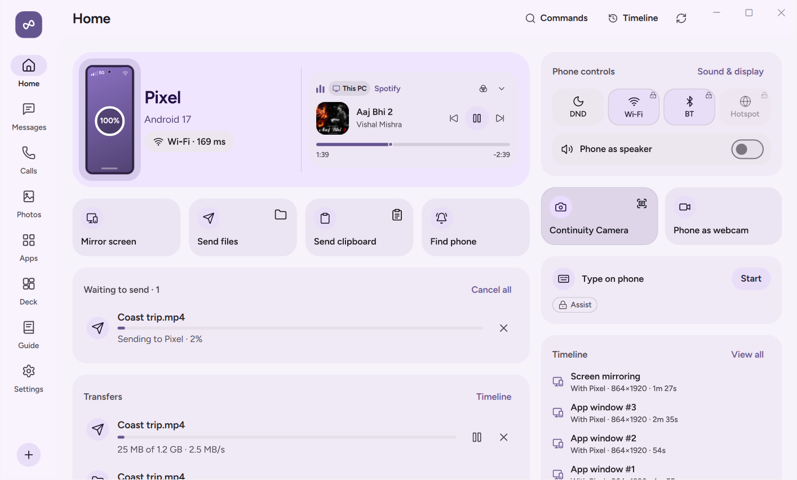

# Files and Transfers

NectarLink transfers files and folders between your phone and PC at full local Wi-Fi or USB speed. Every transfer supports manual pause and resume, automatic recovery after a dropped connection, end-to-end BLAKE3 integrity verification, and an offline `Waiting to send` queue so nothing is lost when the other device is asleep or out of reach. You can also mount your phone's storage directly inside Windows File Explorer, browse your PC's folders from your phone, set up automatic folder sync, and share files with nearby LocalSend devices.

  

## What You Need

| Feature | Requirements |
| :--- | :--- |
| **Send files and folders (both ways)** | `Standard` power level. **Files** toggle enabled in **Settings › Devices** (on by default). No special Android permission is required to send files you pick or share, or to save incoming files into `Download/Nectarlink`. |
| **Phone storage in Windows File Explorer** | Windows 11 (Cloud Files API). Per-PC **Browse this phone's storage in File Explorer** toggle turned on in Android **Settings › Devices** (off by default) and **File Explorer integration** (`storage`) toggle turned on in PC **Settings › Devices** (off by default). On Android, grant either **All files access** or pick specific folders under **Selected folders only**. |
| **Browse PC files from phone ("Your PC in your pocket")** | **Your PC in your pocket** turned on in PC **Settings › Files & Sync** (off by default) and per-device **File Explorer integration** (`storage`) enabled. If connected over **Connect over mobile data** (relay), **Remote PC file access** (`remote_files`, off by default) must also be enabled for that phone. |
| **Synced folders (One-way or Two-way)** | Same storage access on the phone (`All files access` or selected folders) plus a configured folder sync rule in PC **Settings › Files & Sync › Synced folders**. |
| **LocalSend compatibility** | **LocalSend on local network** turned on in PC **Settings › Files & Sync** or Android **Settings › Features & Data › LocalSend** (off by default). Requires both devices to be on the same Wi-Fi LAN. |

## Step-by-Step Use

### Sending Files and Folders from PC to Phone

You can send files or entire folders from your PC using any of these entry points:

1. **Drag and drop**: Drag files or folders onto the NectarLink main window, onto the slide-out `Shelf` edge panel (`Ctrl+Alt+S`), or onto an open `mirror` window.
2. **Flick to send**: Drag a file toward the screen edge where your `Shelf` sits with a quick flick gesture. A 3-second **Undo** toast appears before the transfer begins.
3. **Home screen button**: Click **Send files** on the PC Home screen and pick files or folders.
4. **File Explorer `Send to` menu**: Right-click any file or folder in Windows File Explorer, choose **Send to**, and click your phone's name.
5. **Command Palette or CLI**: Press `Ctrl+Alt+Space` and choose **Send files to phone**, or run `nectarlink send <path>` in a terminal.

Received files on your phone are saved to `Download/Nectarlink` (preserving subfolder structure when you send a folder).

### Sending Files and Folders from Phone to PC

1. **From any Android app**: Tap **Share**, then tap your PC's Direct Share target at the top of the Android share sheet (or tap **NectarLink**). The transfer starts right away; with more than one PC connected, you pick one first. Its progress shows in a notification with a **Cancel** button, followed by a **Sent to** confirmation.
2. **From the NectarLink app**: Open NectarLink on your phone and tap **Send files** or **Send a folder** under **Quick Transfer & Clipboard**.

Received files on your PC are saved to `Downloads\Nectarlink` (avoiding overwrites by adding a numeric suffix if a file with the same name already exists). If **Copy received files** is enabled in **Settings › General**, small received files are also placed on your Windows clipboard so you can paste them anywhere with `Ctrl+V`.

### Pausing, Resuming, and Verifying Transfers

- **Manual Pause and Resume**: While a large file is transferring, click **Pause** in the **Transfers** card on either the PC or the phone to pause the stream at the current byte offset, and click **Resume** whenever you are ready to continue.
- **Automatic Resume on Reconnect**: Incoming files are written to a staging `.part` file. If your Wi-Fi drops or you unplug a USB cable mid-transfer, NectarLink keeps the partial bytes and automatically resumes from the exact byte offset when the connection returns.
- **BLAKE3 Integrity Check**: Every file transfer computes a full-file cryptographic **BLAKE3** hash. The receiver verifies the hash before moving the completed `.part` file to its final destination. If a single byte fails verification, the file is never committed as complete.

### Offline Queue and the `Waiting to send` Panel

When you send files, folders, clipboard items, links, `Handoff` documents, or `notify-when` alerts while your other device is offline, NectarLink does not fail the action. Instead, it queues the item reliably:

1. A confirmation toast lets you know the target device is offline and that your item will be sent automatically when it reconnects, with an **Undo** button.
2. On Home (both PC and Android), a compact **`Waiting to send`** panel appears whenever items are queued, showing the total count and each item's icon, name, target device, size, and status (`Waiting`, `Sending` with live progress, `Failed` with reason, or `Expired`). The system tray tooltip and `Nectar Island` also quietly note how many items are waiting.
3. The queue is stored in SQLite (`send_queue` table) and **survives app restarts and system reboots** on both platforms, holding up to 200 items or 10 GiB of pending files.
4. Queued files are referenced by path and checked before sending (`mtime` and byte size). If a queued file was modified or deleted on disk while waiting, NectarLink stops that item with a clear reason rather than sending unexpected content, and lets you retry or remove it.
5. **Automatic Expiry**: To prevent stale actions from running days later, queued items expire by type:
   - Continuity Camera requests: **2 minutes**
   - Links, clipboard items, and task alerts: **24 hours**
   - Files and folders: **7 days**
6. **Cancelling**: Click **Cancel** next to any single item or **Cancel all** in the `Waiting to send` panel. Cancelling a transfer that is already in progress stops it on both sides and deletes any `.part` staging file on the receiver.
7. As soon as the target device reconnects, queued items drain automatically in first-in, first-out (FIFO) order, and the `Waiting to send` panel disappears once the queue is empty.

### Mounting Phone Storage in Windows File Explorer

You can browse your phone's internal storage or selected folders directly inside Windows File Explorer as if it were a local folder:

1. On your phone, open **Settings › Permissions › Photos and videos** and either allow **All files access** or tap **Add folder** next to **Selected folders only** to pick specific folders with Android's Storage Access Framework picker.
2. Still on your phone, open **Settings › Devices** and turn on **Browse this phone's storage in File Explorer** for your PC.
3. On your PC, open **Settings › Devices**, select your phone, and turn on **File Explorer integration** (or click **Open** next to it). The first time your PC connects to phone storage, your phone also shows a confirmation prompt if storage access was not enabled yet.
4. Windows mounts your phone under `%USERPROFILE%\Nectarlink\<Phone name>` using the native Windows Cloud Files API (`cfapi`).
5. Browse folders at local speed using lightweight file placeholders. When you double-click a file to open it, Windows downloads its contents on demand with native progress bars and sync status icons. You can drag new files into the folder to upload them to your phone, create folders, rename files, and delete files (on Android 11+, deleted media files move to the phone's trash rather than being permanently erased).

### Browsing PC Files from Your Phone ("Your PC in your pocket")

1. On your PC, open **Settings › Files & Sync** and turn on **Your PC in your pocket**, and make sure **File Explorer integration** (`storage`) is enabled for your phone in **Settings › Devices**.
2. If you want to browse PC files while away from home over mobile data (**Connect over mobile data**), also turn on **Remote PC file access** (`remote_files`) for that phone in **Settings › Devices**.
3. On your phone, tap **PC files** on the Home screen to browse your PC's shared folders (`Downloads`, `Documents`, `Desktop`, `Pictures`, and `NectarLink Shared`), download files to your phone on demand, or upload files from your phone to a PC folder.

### Automatic Folder Sync

To keep a phone folder (such as `DCIM/Camera` or a notes directory) synchronized with a folder on your PC:

1. On your PC, open **Settings › Files & Sync** and scroll to the **Synced folders** card.
2. Click **Add DCIM to Pictures** (or configure a custom phone folder and PC folder pair) and choose between:
   - **One-way (phone to PC)**: Mirrors new and updated files from the phone folder (and subfolders up to 3 levels deep) into the PC folder without pushing PC changes back to the phone.
   - **Two-way sync**: Synchronizes additions and updates in both directions. If the same file is modified on both devices between syncs, NectarLink preserves both versions by saving a conflict copy rather than overwriting your work.
3. Every synced file streams to a temporary `.nectarlink.part` file and verifies its byte length and **BLAKE3** hash before replacing the destination file. Click **Sync now** to run all enabled rules immediately, or toggle individual rules on and off.

### LocalSend Compatibility

NectarLink includes a built-in LocalSend v2.1 client and server so you can exchange files with any nearby phone, tablet, Mac, Linux machine, or Windows PC running the LocalSend app without pairing:

1. Turn on **LocalSend on local network** in **Settings › Files & Sync** on your PC or **Settings › Features & Data › LocalSend** on your phone.
2. Nearby LocalSend devices on the same Wi-Fi network (UDP multicast `224.0.0.167:53317` and TCP port `53317`) appear automatically in NectarLink's LocalSend list, and your device appears in theirs.
3. Because LocalSend is an unauthenticated LAN protocol, **every incoming LocalSend transfer requires your explicit approval** (`Accept` or `Decline`) before a single byte is written to disk.

## What the Options Do

- **File Explorer Send to** (`Settings › Files & Sync` on PC, default: **On**): Adds paired phones to the right-click `Send to` menu in Windows File Explorer.
- **Your PC in your pocket** (`Settings › Files & Sync` on PC, default: **Off**): Allows paired phones with storage permission to browse your PC's user folders (`Downloads`, `Documents`, `Desktop`, `Pictures`).
- **LocalSend on local network** (`Settings › Files & Sync` on PC and `Settings › Features & Data › LocalSend` on Android, default: **Off**): Enables un-paired LAN file sharing with LocalSend devices.
- **Synced folders** (`Settings › Files & Sync` on PC): Manages one-way and two-way folder synchronization rules.
- **Copy received files** (`Settings › General` on PC, default: **On**): Places small incoming files on the Windows clipboard for immediate `Ctrl+V` pasting.
- **Transfer history** (`Settings › Storage & Privacy` on PC and `Settings › Features & Data › Data & storage` on Android): Clears the record of completed transfers without deleting any saved files in your `Downloads` folder.

## Data and Privacy

- **Where data travels**: All transfers between paired devices use end-to-end encrypted QUIC streams. LocalSend transfers use HTTPS on your local Wi-Fi network.
- **Path sandboxing**: Both NectarLink's paired storage provider and the LocalSend receiver strictly sanitize all file paths and filenames, rejecting `..` parent traversal, drive prefixes, reserved Windows device names (`CON`, `NUL`, `COM1`), and symlink escapes outside the shared root.
- **Where data stays**: Received files stay in `Downloads\Nectarlink` on Windows and `Download/Nectarlink` on Android. Clearing **Transfer history** or **Timeline** only removes the log entries; your downloaded files on disk are never touched.

## Limits

- **Windows Share Sheet Target (`windows.shareTarget`)**: Sending files via drag-and-drop, File Explorer's right-click **Send to** menu, the Explorer context menu, the `Shelf`, and `nectarlink --share` works on all standard Windows installs. Appearances inside the system-wide Windows 11 `Win+Share` popup sheet require NectarLink's sparse package manifest to be registered with a trusted code-signing certificate or Windows Developer Mode enabled.
- **Queue Bounds**: The offline `Waiting to send` queue holds up to **200 items** or **10 GiB** of pending files per device. Live interactive features (screen mirroring, webcam, remote input, and ringing a device) are never queued because they only make sense while the device is online.
- **Folder Sync Depth**: Recursive folder sync traverses up to 3 levels of subdirectories inside each configured folder pair.
