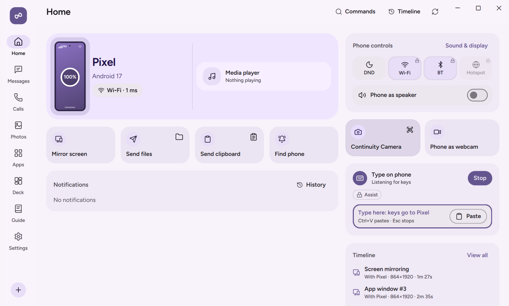

# Input and Control

NectarLink lets you control your PC from your phone and control your phone from your PC. Use your phone as a multi-touch trackpad, gyroscope air mouse, remote keyboard, voice dictation mic, presentation clicker with a laser pointer, `Deck` macro pad, or bedside `Desk clock` display. Going the other way, type on your phone from your PC keyboard without screen mirroring, move your PC mouse cursor across the screen edge onto your phone (**Flow**), toggle phone system settings from PC Home, or lock, sleep, and wake your PC remotely.

  

## What You Need

| Feature | Requirements |
| :--- | :--- |
| **Control PC from phone (Touchpad, Air mouse, Keyboard, Voice dictation, Presentation remote)** | `Standard` power level on Android. Per-phone **Remote mouse, keyboard & Deck** (`remote_input`) toggle enabled on the PC in **Settings › Devices** (off by default; the PC shows a one-time consent prompt the first time your phone asks). Air mouse requires a phone gyroscope sensor; Voice dictation requires Android **Microphone** permission (`RECORD_AUDIO`). |
| **Type on phone from PC keyboard (without mirroring)** | `Assist` (Android Accessibility Service) or `Elevated` (Wireless Debugging) on the phone. |
| **`Deck` macro pad** | Per-phone **Remote mouse, keyboard & Deck** (`remote_input`) toggle enabled on the PC. Tiles that run custom PC shell commands also require the separate per-phone **Run Deck shell commands** (`commands`) toggle in PC **Settings › Devices** (off by default). |
| **Phone controls on PC Home** | `Standard` for Media volume, Ringer mode (Ring/Vibrate), and Flashlight. **Do Not Disturb and silent mode** requires Android Notification Policy Access (**Settings › Permissions › Control from your PC**). **Screen brightness** requires Android Modify system settings. **Wi-Fi** and **Bluetooth** toggles require `Elevated` (which also grants DND and brightness permissions automatically). |
| **Lock, Sleep, and Wake-on-LAN** | **Lock, sleep & wake PC** (`pc_actions`) toggle enabled in PC **Settings › Devices** (on by default). Wake-on-LAN requires a PC network adapter with Wake on LAN enabled in Windows Device Manager and BIOS/UEFI (typically Ethernet). |

## Step-by-Step Use

### 1. Controlling Your PC from Your Phone

Tap **Control PC** on the Android Home screen. The first time you open it, click **Allow** on the prompt shown on your PC (or turn on **Remote mouse, keyboard & Deck** in PC **Settings › Devices**). Choose from three modes at the top of the phone screen:

#### Touchpad Mode

- **Move cursor**: Drag one finger across the pad. Adjust pointer speed (`0.5x` to `2.5x`) in Android **Settings › Features & Data › Control your PC › Touchpad speed**.
- **Left-click**: Tap with one finger, or tap the **Left** button below the pad.
- **Right-click**: Tap with two fingers, or tap the **Right** button.
- **Middle-click**: Tap the **Middle** button.
- **Scroll**: Drag two fingers up, down, left, or right.
- **Click and drag**: Double-tap and hold with one finger, then drag.

#### Air Mouse Mode

- Hold your thumb on the center pad and tilt your phone in the air. NectarLink reads your phone's gyroscope with hand-tremor filtering to move the PC cursor accurately where you point.
- Tap the pad while holding to left-click, and release the pad to park the cursor. (If your phone does not have a gyroscope sensor, NectarLink lets you know and suggests Touchpad mode.)

#### Keyboard and Voice Dictation

- **Remote Keyboard**: Tap **Keyboard** to open your phone's soft keyboard and type straight into the focused window on your PC. Above the keyboard sits a scrollable bar of PC modifier and special keys: **`Ctrl`**, **`Alt`**, **`Shift`**, **`Win`**, **`Esc`**, **`Tab`**, **Arrow keys**, **`Home`**, **`End`**, **`PgUp`**, **`PgDn`**, **`Del`**, **`Copy`**, and **`Paste`**. Tap a modifier key (`Ctrl`, `Alt`, `Shift`, `Win`) to latch it for the next keystroke.
- **Voice Dictation**: Tap or hold **Dictate** and speak. NectarLink uses your phone's speech recognizer (on-device recognition where available) to stream live partial transcripts and type the finished sentence directly into the active text field on your PC.

#### Presentation Remote and Laser Pointer

Switch to **Presentation** mode when giving a talk or slideshow:

- Tap **Next slide** or **Previous** to step through slides. While the Presentation screen is open on your phone, your phone's physical **Volume Up** and **Volume Down** buttons also advance or go back a slide without looking at the screen.
- Tap **Start show** (`F5`), **End show** (`Esc`), or **Black screen** (`B`) to control PowerPoint, Google Slides, Keynote Web, or PDF presenters.
- **Hold for laser pointer**: Press and hold the laser button to project a bright, accent-colored laser dot overlay onto your PC monitor that follows how you tilt your phone (via gyroscope) or drag your finger.

### 2. Typing on Your Phone from Your PC Keyboard (Without Mirroring)

When your phone is sitting on a stand next to your monitor and you just want to type a quick message or search on the phone using your physical PC keyboard without opening a screen-mirroring window:

1. On PC **Home**, click **Type on phone** (or open the `Command Palette` with `Ctrl+Alt+Space` and select **Type on phone with PC keyboard**).
2. While the **Type on phone** card is active on your PC, every keystroke you type (including letters, numbers, Unicode text, **Arrow keys**, **Backspace**, **Enter**, and `Ctrl+V` clipboard paste) goes straight into the focused text field on your phone.
3. Your phone displays a top banner (**Typing from `<PC>`**) with a one-tap **Stop typing** button, and pressing **Escape** on your PC ends keyboard capture immediately.

### 3. `Deck`: Customizable Macro Pad and PC Audio Controller

`Deck` turns your phone into a tactile, multi-page button grid and live audio controller for your PC:

1. **Using `Deck` on your phone**: Tap **Deck** on the Android Home screen.
   - The header gives you a live **PC master volume slider**, a **Mute** button, and an **Output device switcher** showing which speaker or headset is active on your PC.
   - Swipe left or right between pages of action tiles, or tap **Full screen** to fill your phone in portrait or landscape with haptic feedback on every press.
   - Live tiles update in real time to show whether PC media is **Playing** or **Paused**, the current speaker volume percentage, and whether your PC microphone is **Muted** or **Live**.
2. **Customizing `Deck` on your PC**: Click **Deck** in the left navigation bar on your PC.
   - Drag and drop tiles to reorder them, add new pages, and customize each tile's label, icon, and color.
   - Choose from built-in tile types: **Play / Pause**, **Previous**, **Next**, **Volume up / down / mute**, **Microphone mute**, **Lock PC**, **Show desktop**, **Switch window**, **Screenshot**, **Keyboard shortcut** (any custom hotkey combo), **Open web link**, **Type text snippet**, **Launch application** (`.exe` or `.lnk`), or **Run shell command**.
   - **Security gate for shell commands**: Tiles that execute custom PC shell commands are blocked unless you also turn on **Run Deck shell commands** (`commands`, off by default) for that phone in PC **Settings › Devices**.

### 4. Phone Controls on PC Home

The **Phone controls** section on your PC's Home screen lets you check and toggle your phone's hardware and sound settings from your desk:

- **Media volume**: Drag the slider to change your phone's media playback volume.
- **Ringer mode**: Switch between **Ring**, **Vibrate**, and **Silent**.
- **Do Not Disturb**: Toggle Do Not Disturb on or off (or switch notification profiles between **All**, **Priority only**, and **Silent**).
- **Flashlight**: Turn your phone's rear flashlight on or off.
- **Screen brightness**: Drag the slider to adjust your phone's display brightness.
- **Wi-Fi and Bluetooth** (available at `Elevated`): Toggle your phone's Wi-Fi or Bluetooth radios. Turning Wi-Fi off from the PC asks for confirmation first so you do not accidentally drop a Wi-Fi connection.

### 5. Desk Mode (`Desk clock`) on Android

When your phone is resting on a charger or desk stand, tap **Desk clock** on the Android Home screen to switch into **Desk Mode**: a calm, high-contrast landscape or portrait stand display showing the time, connection status, live PC media artwork and transport controls, and quick actions designed for OLED screens.

### 6. Lock, Sleep, Find My Device, and Wake-on-LAN

- **Find my device (both ways)**: Click **Find phone** on PC Home to ring your phone at full volume on the alarm audio stream (even if the phone is on silent or Do Not Disturb). Tap **Ring PC** on your phone (or on the Android home-screen widget) to play an alert chime on your PC.
- **Lock or Sleep PC**: Tap **Lock PC** or **Sleep** on your phone (or on the Android **PC quick actions** widget) to lock your Windows session or put the PC to sleep when you walk away.
- **Wake PC (Wake-on-LAN)**: When your PC is asleep or powered off, tap **Wake** on your phone (or on the Android home-screen widget).
  - On the local network, your phone sends Wake-on-LAN UDP packets to every MAC and broadcast address stored for your PC during prior connections.
  - If you have another NectarLink device online on your home LAN while you are on mobile data (**Connect over mobile data**), NectarLink can also relay the wake request through your online home device.
  - Check **Settings › Connection & About › Wake from your phone** on your PC to verify whether your Windows network adapter has Wake on LAN enabled in Device Manager.

## What the Options Do

- **Remote mouse, keyboard & Deck** (`Settings › Devices` on PC, default: **Off**): Allows the selected phone to control the PC's mouse, keyboard, presentation remote, and standard `Deck` tiles.
- **Run Deck shell commands** (`Settings › Devices` on PC, default: **Off**): Allows the selected phone to trigger `Deck` tiles that execute custom shell commands on the PC.
- **Phone controls** (`Settings › Devices` on PC, default: **On**): Allows the PC to view and change the phone's volume, ringer, DND, flashlight, brightness, Wi-Fi, and Bluetooth.
- **Lock, sleep & wake PC** (`Settings › Devices` on PC, default: **On**): Allows the selected phone to lock or sleep the PC and learn its MAC address for Wake-on-LAN.
- **Touchpad speed** (`Settings › Features & Data › Control your PC` on Android, default: `1.0x`): Adjusts pointer sensitivity from `0.5x` to `2.5x`.

## Data and Privacy

- **Consent before remote input**: Incoming mouse, keyboard, and `Deck` input from a phone is **off by default** on the PC and prompts for your approval the first time a paired phone requests control. Custom shell command tiles require a second, separate per-device toggle (**Run Deck shell commands**) that you must turn on manually in PC Settings.
- **Visible banner when typing on phone**: Whenever your PC keyboard is typing into your phone via **Type on phone**, your phone shows an active banner (**Typing from `<PC>`**) with a one-tap **Stop typing** button.
- **Voice dictation**: Voice typing uses Android's system `SpeechRecognizer` (preferring on-device recognition when installed on your phone) and sends only the recognized text strings over your encrypted QUIC connection to the PC.

## Limits

- **Wake-on-LAN Hardware Requirements**: Waking a sleeping or powered-off PC over the network requires Wake-on-LAN to be enabled in your PC's BIOS/UEFI and in your network adapter's Windows Device Manager properties (**Power Management › Allow this device to wake the computer**). Most desktop Ethernet adapters support waking from both sleep (`S3`) and shutdown (`S5`), whereas many laptop Wi-Fi cards only support waking from low-power standby (`S0ix`) or sleep, not full shutdown.
- **Wi-Fi and Bluetooth Toggles on Android 10+**: Starting in Android 10, regular apps cannot toggle Wi-Fi or Bluetooth directly. Those two toggles on PC Home require the `Elevated` power level on your phone.
