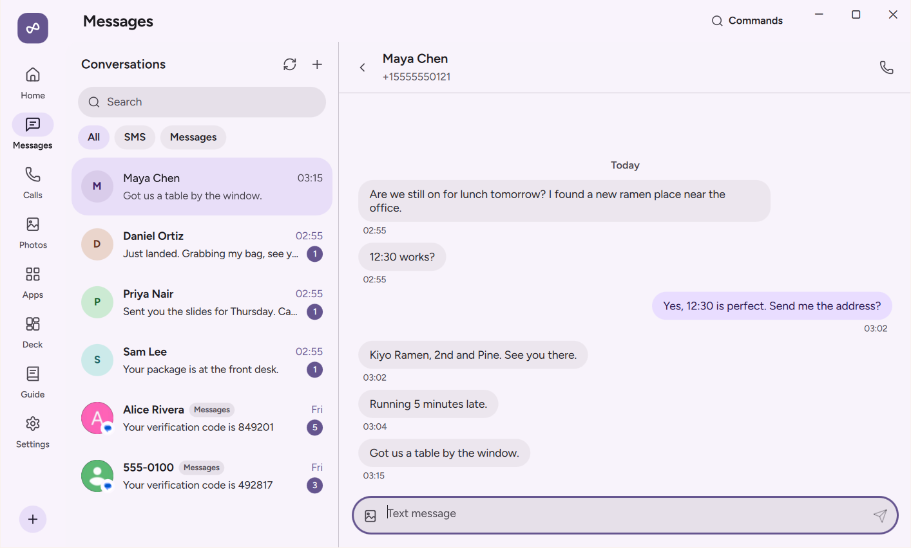
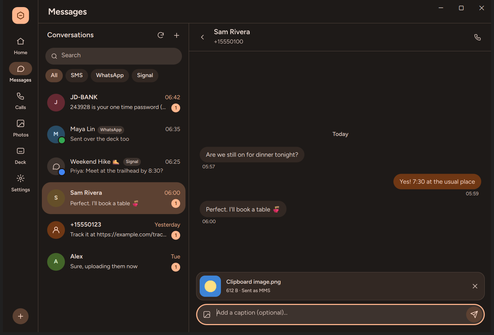

# Messages

The **Messages** page on your PC brings together your phone's SMS and MMS text threads alongside **Unified Conversations** from RCS, WhatsApp, Telegram, Signal, and other messaging apps. You can read threads, search contacts, send texts and image attachments, schedule messages for later, copy verification codes, and filter spam from one inbox.

  

## What You Need

| Requirement | Details |
| :--- | :--- |
| **Android Permissions** | **Text from your PC** (`READ_SMS`, `SEND_SMS`, `RECEIVE_SMS`) for SMS and MMS threads; **Contacts on your PC** (`READ_CONTACTS`) to show contact names and photos; **Show notifications on your PC** (Notification access) for Unified Conversations from third-party chat apps. |
| **Android Power Level** | `Standard` (all messaging features work without `Assist` or `Elevated`). |
| **Per-Device Toggles** | **Messages** and **Contacts** (both enabled by default in **Settings › Devices** on the PC). |
| **Network** | Local network, USB cable, or **Connect over mobile data**. |

## Step-by-Step Use

### Reading SMS, MMS, and Chat App Threads

1. Click **Messages** in the left navigation bar on your PC.
2. The left pane lists your conversations ordered by most recent activity:
   - **SMS and MMS threads** are synced directly from your phone's system telephony database, including group MMS conversations and inline picture attachments.
   - **Unified Conversations** capture incoming messages from chat apps that use Android's `MessagingStyle` notification format (such as Google Messages RCS, WhatsApp, Telegram, Signal, Discord, and Slack). Each thread badge shows which app it belongs to. NectarLink automatically deduplicates SMS notifications against the system SMS provider so texts never appear twice.
3. When chat apps are present, chips at the top of the list filter conversations by app. The search box filters threads by contact name, phone number, app, or message text.

### Sending Texts and Replying to Chat Apps

1. Select any conversation in the list to open its message history on the right.
2. Click the message composer at the bottom, type your message, and press **Enter** to send (or `Shift+Enter` to insert a new line).
   - In an **SMS/MMS thread**, your phone sends the text through your cellular carrier (automatically splitting long messages into multi-part SMS when needed) and writes the sent message to your phone's SMS database.
   - In a **Unified Conversation** (such as WhatsApp or Signal), your phone sends the reply through that app's active `RemoteInput` notification channel.

### Sending Picture Attachments (MMS)

You can attach images to any SMS/MMS conversation in three ways:

  

1. **Paste from clipboard**: Copy any image on your PC and press `Ctrl+V` inside the message composer.
2. **Drag and drop**: Drag a `.png`, `.jpg`, `.webp`, or `.gif` image file from File Explorer or the `Shelf` onto the conversation pane.
3. **Attachment picker**: Click the attachment icon (`+` or paperclip) in the composer and choose an image file from your PC.
4. A thumbnail preview appears above the text box. Add an optional caption and press **Enter** to send the image as an MMS through your phone's cellular connection.

### Starting a New Conversation

1. Click the **New message** button at the top of the conversation list.
2. Type a contact's name or phone number in the **To:** field. NectarLink searches your phone's synced contacts as you type, showing matching names, phone numbers, and contact avatars.
3. Click a contact (or finish typing a phone number), write your message in the composer, and press **Enter**.

### One-Time Codes

When an SMS or chat message contains a verification code, NectarLink displays a **Copy code** button right inside the message bubble (and copies it automatically if **Copy one-time codes** is turned on in **Settings › General**).

## What the Options Do

- **Messages toggle** (`Settings › Devices` on PC, **On** by default): Allows this phone and PC to sync SMS/MMS conversations, Unified Conversations, and outgoing replies.
- **Contacts toggle** (`Settings › Devices` on PC, **On** by default): Syncs contact names, phone numbers, and avatars so threads display people's names instead of raw numbers.
- **Copy one-time codes** (`Settings › General` on PC, **Off** by default): Copies verification codes from incoming SMS messages to the PC clipboard automatically.
- **Cached messages** (`Settings › Storage & Privacy` on PC and `Settings › Features & Data › Data & storage` on Android): Shows how many chat threads, messages, and MMS attachment bytes are cached locally, with a **Clear** button to wipe the local cache at any time.

## Data and Privacy

- **Where data travels**: SMS threads, MMS attachments, contact records, and Unified Conversation messages are transmitted directly between your phone and PC over your end-to-end encrypted QUIC connection.
- **Where data stays**:
  - On your **phone**, SMS and MMS messages live in Android's system telephony provider (`content://sms` and `content://mms`). Temporary staging files used when building or receiving MMS attachments are stored in the app's private cache and deleted automatically within 5 minutes.
  - On your **PC**, Unified Conversations (`MessagingStyle` chat threads) are cached in your local SQLite database (`%LOCALAPPDATA%\Nectarlink\nectarlink.db` in `chat_threads` and `chat_messages`) and MMS image attachments are stored in `%LOCALAPPDATA%\Nectarlink\cache\images\` for up to **90 days** so conversations open without delay. Clicking **Clear** next to **Cached messages** in **Settings › Storage & Privacy** removes all locally cached messages and attachments on the PC without deleting any texts on your phone.

## Limits

- **Chat App Reply Window (`RemoteInput`)**: Unified Conversations from third-party apps (such as WhatsApp, Signal, or Telegram) rely on the `RemoteInput` action attached to that app's notification on Android. You can reply to a chat app conversation as long as its notification (or session action) remains active on the phone, and you cannot start a brand-new WhatsApp or Signal thread with someone who has not messaged you first.
- **RCS Messages in Google Messages**: Android does not expose a public third-party API for reading or sending RCS messages directly through the database. RCS messages that arrive while connected appear as Unified Conversations via `MessagingStyle` notifications (supporting inline text replies), whereas messages you initiate from the **New message** composer are sent as standard SMS or MMS.
- **Carrier MMS Size Limits**: Outgoing MMS pictures are compressed automatically to fit standard carrier MMS limits (typically 600 KB to 1.2 MB depending on your mobile operator). For full-resolution photo transfers, use [Photos](photos.md) or [Files and Transfers](files-and-transfers.md).
