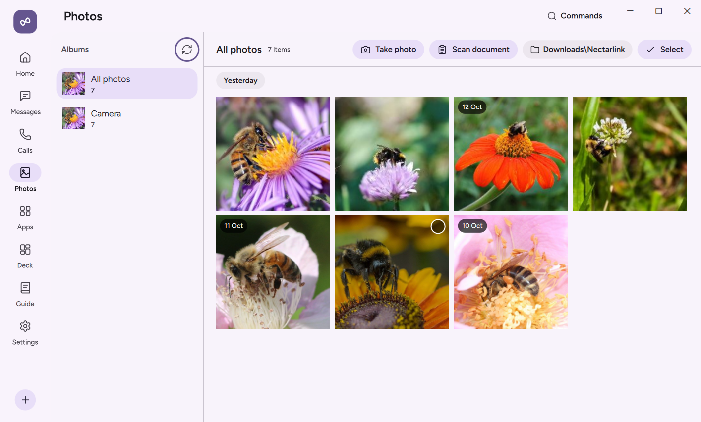

# Photos

The **Photos** page on your PC gives you instant access to your phone's camera roll, screenshots, and albums without plugging in a cable or uploading your gallery to a cloud photo service. You can browse thumbnails grouped by day, inspect full-resolution photos, drag images straight into File Explorer or desktop editing apps, and get notified on your PC the moment you take a new photo or screenshot on your phone.

  

## What You Need

| Requirement | Details |
| :--- | :--- |
| **Android Permission** | **Photos and videos on your PC** (`READ_MEDIA_IMAGES` and `READ_MEDIA_VIDEO` on Android 13+, or `READ_EXTERNAL_STORAGE` on Android 12 and earlier) in **Settings › Permissions › Photos and videos**. On Android 14+, you can grant full access (**Allow all**) or pick specific photos (**Select photos**). |
| **Android Power Level** | `Standard` (works out of the box with no accessibility or developer setup). |
| **Per-Device Toggle** | **Photos** (enabled by default in **Settings › Devices** on the PC). |
| **Network** | Local network, USB cable, or **Connect over mobile data**. |

## Step-by-Step Use

### Browsing Your Camera Roll, Screenshots, and Albums

1. Click **Photos** in the left navigation bar on your PC.
2. Use the album filter pills at the top (**All**, **Camera**, **Screenshots**, or any custom album from your phone's `MediaStore`) to narrow the grid.
3. Photos are grouped chronologically by day. As you scroll, NectarLink streams lightweight thumbnails from your phone and caches them locally so scrolling stays responsive even across galleries with 10,000+ photos.
4. Additionally, the **Home** screen and the slide-out `Shelf` edge panel (`Ctrl+Alt+S`) always show quick cards for your phone's **Latest photo** and **Latest screenshot**.

### Viewing Full-Resolution Photos

1. Click any thumbnail in the **Photos** grid to open the full-resolution viewer inside NectarLink.
2. NectarLink streams the original, uncompressed image file from your phone on demand.
3. Use the **Left** and **Right** arrow keys on your keyboard to step through your gallery, or press **Escape** to return to the grid.
4. From the viewer toolbar, you can:
   - Click **Copy** (`Ctrl+C`) to copy the full-resolution image onto your Windows clipboard so you can paste it into any document, chat app, or image editor.
   - Click **Save** (`Ctrl+S`) to save the original file to `Downloads\Nectarlink` (or pick a custom destination folder).
   - Click **Open in Photos** to open the downloaded original in the default Windows photo viewer.

### Dragging Photos Out to File Explorer or Apps

You do not need to click Save before using a photo in another Windows program:

1. Point at any photo tile on the **Photos** page, on the **Home** screen, or inside the slide-out `Shelf`.
2. Click and drag the photo directly onto your Windows Desktop, into a File Explorer folder, or into an open app (such as PowerPoint, Photoshop, Figma, Slack, or your web browser).
3. NectarLink stages the full-resolution file with its original sanitized filename (for example, `IMG_20261012_091500.jpg`) so the receiving app gets the real file immediately.

### Selecting and Saving Multiple Photos

1. Hover over a photo tile and click its selection check mark (or hold `Shift` / `Ctrl` while clicking) to select multiple photos.
2. In the selection bar at the top, click **Save selected** to download all chosen originals to `Downloads\Nectarlink` (or a folder you pick) in one batch.

### New Photo and Screenshot Alerts on Your PC

Whenever you take a new photo or capture a screenshot on your phone while connected:

1. Your phone's `MediaStore` observer detects the new capture immediately and notifies your PC.
2. A notification with a live thumbnail preview pops up on your PC (and updates the **Latest photo** / **Latest screenshot** slots on Home and in the `Shelf`), with one-click buttons to **Copy** the image to your clipboard or **Save** it to disk.

## What the Options Do

- **Photos toggle** (`Settings › Devices` on PC, default: **On**): Allows your PC to browse the phone's gallery and receive new photo/screenshot notifications.
- **Photos and videos on your PC** (`Settings › Permissions › Photos and videos` on Android): Manages Android's media permission. If you previously chose **Select photos** (partial access on Android 14+), tap **Allow all** here if you want your whole gallery visible on the PC.
- **Photo thumbnails** (`Settings › Storage & Privacy` on PC and `Settings › Features & Data › Data & storage` on Android): Shows the number and disk size of cached thumbnails on the PC (kept for up to 30 days) and temporary camera captures on the phone (kept for up to 24 hours), with a **Clear** button to remove the cache at any time.

## Data and Privacy

- **On-demand reading**: NectarLink never bulk-uploads your photo library in the background. Your phone reads photo metadata and thumbnails directly from Android's `MediaStore` only when you open the **Photos** page (or for the single latest photo/screenshot on Home), and full-resolution originals are transferred only when you view, copy, drag, or save a specific photo.
- **Local cache retention**: Thumbnail previews downloaded to your PC are stored in `%LOCALAPPDATA%\Nectarlink\cache\photos\` and automatically purged after **30 days**. Drag-and-drop staging files in `%LOCALAPPDATA%\Nectarlink\cache\photos\drag\` are cleaned up automatically. Clicking **Clear** next to **Photo thumbnails** in **Settings › Storage & Privacy** wipes all cached thumbnails on your PC without affecting any photos on your phone or any files you saved to `Downloads`.

## Limits

- **Android 14+ Partial Photo Access**: If you choose **Select photos** instead of **Allow all** when Android prompts for media access, Android only reveals the specific photos you picked to NectarLink. NectarLink displays an inline notice in Android Settings (**Some of your photos and videos aren't available on your PC**) with an **Allow all** button so you can expand access whenever you want.
- **Cloud-Only Backed-Up Photos**: NectarLink reads photos stored locally on your phone's storage (`MediaStore`). Older photos that have been deleted from your phone's local storage by a cloud backup service (such as Google Photos "Free up space") are not on the device and will not appear unless downloaded back to the phone.
